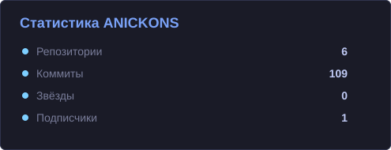
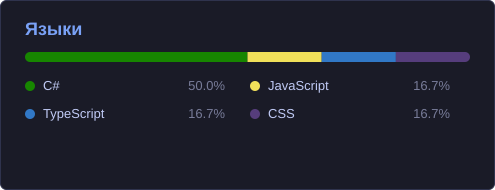

 

## Коротко о себе

Я ANICKON. Пишу десктопные приложения на Electron и React и моды для игр на C#. Тестирование для меня часть разработки, а не отдельный шаг в конце: я знаю, как всё это ломается изнутри, поэтому в своих проектах не оставляю проверку на потом.

Что из тестирования у меня уже есть в проектах:

- **Автоматические сценарии.** В MOP-REVIVAL и My-Summer-Frames есть внутриигровой тест-бот со сценариями. Отдельный скрипт ставит сборку в игру, прогоняет сессию и потом возвращает сохранение и настройки как было.
- **Замеры перед релизом.** Любое изменение производительности я проверяю в самой игре: FPS до и после, на конкретной видеокарте. Без цифр в релиз не идёт.
- **Совместимость.** Для MOP-REVIVAL есть правила под 43 других мода и публичная [страница совместимости](https://anickons.github.io/MOP-REVIVAL/), где видно, что с чем работает.
- **Багрепорты.** В моде есть кнопка «Report bug», которая сама прикладывает логи, чтобы баг было легко воспроизвести.
- **Проверка данных.** В ULTIMA редактор проверяет обязательные поля и подсвечивает ошибки в переводе, а не даёт сохранить сломанный файл.
- **Веб.** В IDELUXE-STUDIO перед выпуском прогоняю lint, проверку типов и production-сборку, плюс ручные проверки в браузере.

## Главные проекты

### [ULTIMA](https://github.com/ANICKONS/ULTIMA): редактор для перевода модов Baldur's Gate 3

Открываешь `.pak` или `.xml`, слева оригинал, справа перевод. Можно переводить через Google Translate или локальную модель через Ollama. Есть поиск и фильтры по таблице, защита от потери несохранённых изменений, история проектов и автообновление через GitHub Releases.

К нему есть набор вспомогательных инструментов, [ULTIMA_TOOLS](https://github.com/ANICKONS/ULTIMA_TOOLS): один вытаскивает строки из .NET-сборок модов и возвращает их обратно, другой переводит строки чужого мода прямо в памяти, не трогая его .dll. Сборку и выпуск релизов делает GitHub Actions.

`Electron` `React 19` `Vite` `Tailwind` `C#` `.NET`

### [IDELUXE-STUDIO](https://github.com/ANICKONS/IDELUXE-STUDIO): сайт платформы для видеомонтажёра IDELUXE

Лендинг с космическим фоном (звёзды на canvas, планета на WebGL), тарифы с оплатой через Telegram-бота, вход по почте, через Telegram и Google, каталог туториалов с плеером и прогрессом просмотра, каталог ресурсов и ИИ-ассистент для старшего тарифа. Код разложен по модулям (`features`, `content`, `config`), дизайн-система собрана на токенах.

`Next.js 16` `React 19` `TypeScript` `Tailwind 4` `Better Auth` `SQLite`

## Другие проекты

**[MOP-REVIVAL](https://github.com/ANICKONS/MOP-REVIVAL)** — мод, который повышает FPS в My Summer Car. Продолжение старого MOP, переделанное под нынешнюю версию игры. Интерфейс на английском, русском и польском.
`C#` `MSCLoader` `Unity`

**[My-Summer-Frames](https://github.com/ANICKONS/My-Summer-Frames)** — мод, который добавляет в My Summer Car DLSS, FSR, генерацию кадров и NVIDIA Reflex. Игра старая (Unity 5, DirectX 11), поэтому векторы движения я считаю сам из буфера глубины, а генерацию кадров запускаю через отдельный мост на DirectX 12. Проверял на RTX 5070 Ti.
`C#` `C++` `DirectX` `DLSS` `FSR`

**[Cyberpunk Mod Launcher](https://github.com/ANICKONS/cyberpunk-unreal-launcher)** — лаунчер для сборки модов Cyberpunk 2077 в стиле Найт-Сити. Скачивает и ставит сборку одной кнопкой, следит за версиями, запускает игру через Mod Organizer 2.
`Electron` `React` `TypeScript`

## С чем работаю

<b>Статистика GitHub</b>

 

## Связаться

Почта: [anickon.mi@gmail.com](mailto:anickon.mi@gmail.com) · Telegram: [@An1ckon](https://t.me/An1ckon) · VK: [vk.com/anickon](https://vk.com/anickon)

